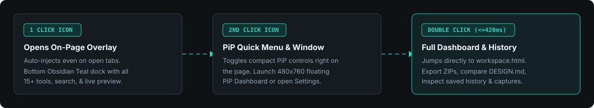

<div align="center">
  
  <br /><br />
  
  
  
  
  
  <a href="https://github.com/QuantumSenpai/pagesift/releases/latest">
    
  </a>
  <a href="https://github.com/QuantumSenpai/pagesift/releases/latest/download/pagesift-extension.zip">
    
  </a>
</div>

---

## 🚀 One-Click Download & Install

<div align="center" style="margin: 24px 0;">

<a href="https://github.com/QuantumSenpai/pagesift/releases/latest/download/pagesift-extension.zip" 
   target="_blank" rel="noopener noreferrer"
   style="
     display: inline-flex;
     align-items: center;
     gap: 10px;
     padding: 14px 28px;
     background: linear-gradient(135deg, #0d9488 0%, #0f766e 50%, #0d9488 100%);
     background-size: 200% 200%;
     animation: shimmer 3s ease-in-out infinite;
     color: #ffffff;
     font-weight: 700;
     font-size: 16px;
     text-decoration: none;
     border-radius: 12px;
     box-shadow: 
       0 4px 16px rgba(13, 148, 136, 0.4),
       0 0 0 1px rgba(13, 148, 136, 0.2),
       inset 0 1px 0 rgba(255,255,255,0.15);
     transition: transform 0.2s ease, box-shadow 0.2s ease;
   "
   onmouseover="this.style.transform='translateY(-2px) scale(1.02)'; this.style.boxShadow='0 8px 24px rgba(13, 148, 136, 0.5), 0 0 0 1px rgba(13, 148, 136, 0.3), inset 0 1px 0 rgba(255,255,255,0.2)'"
   onmouseout="this.style.transform='translateY(0) scale(1)'; this.style.boxShadow='0 4px 16px rgba(13, 148, 136, 0.4), 0 0 0 1px rgba(13, 148, 136, 0.2), inset 0 1px 0 rgba(255,255,255,0.15)'"
>
  <svg width="22" height="22" viewBox="0 0 24 24" fill="none" stroke="currentColor" stroke-width="2.5" stroke-linecap="round" stroke-linejoin="round" style="animation: bounce 1.5s ease-in-out infinite;">
    <path d="M21 15v4a2 2 0 0 1-2 2H5a2 2 0 0 1-2-2v-4"></path>
    <polyline points="7 10 12 15 17 10"></polyline>
    <line x1="12" y1="15" x2="12" y2="3"></line>
  </svg>
  <span>Download PageSift v1.1.0 Extension (ZIP)</span>
  <svg width="18" height="18" viewBox="0 0 24 24" fill="none" stroke="currentColor" stroke-width="2" stroke-linecap="round" stroke-linejoin="round" style="margin-left: 4px; animation: arrowPulse 1.2s ease-in-out infinite;">
    <path d="M5 12h14"></path>
    <path d="M12 5l7 7-7 7"></path>
  </svg>
</a>

<style>
@keyframes shimmer {
  0%, 100% { background-position: 0% 50%; }
  50% { background-position: 100% 50%; }
}
@keyframes bounce {
  0%, 100% { transform: translateY(0); }
  50% { transform: translateY(-3px); }
}
@keyframes arrowPulse {
  0%, 100% { transform: translateX(0); opacity: 1; }
  50% { transform: translateX(4px); opacity: 0.7; }
}
</style>

</div>

> **⚡ Direct link**: [`pagesift-extension.zip`](https://github.com/QuantumSenpai/pagesift/releases/latest/download/pagesift-extension.zip) — Always points to the latest release artifact (~920 KB, Manifest V3, zero dependencies)

**Install in 30 seconds:**

1. Click the button above → saves `pagesift-extension.zip`
2. Open **`chrome://extensions`** (or **`brave://extensions`** / **`edge://extensions`**)
3. Enable **Developer mode** (top-right toggle)
4. Click **Load unpacked** → select the extracted `pagesift-extension` folder
5. Pin **PageSift** 🔍 in your toolbar — done!

---

## Build Locally (Alternative)

Prefer building from source? Zero external deps, fully reproducible:

```bash
git clone https://github.com/QuantumSenpai/pagesift.git
cd pagesift
npm ci
npm run build:extension        # → dist/extension + dist/pagesift-extension.zip
npm run validate:extension     # verifies manifest, CSP, icons, fonts, ZIP
```

1. Open **`chrome://extensions`** or **`brave://extensions`**.
2. Enable **Developer mode** (top-right).
3. Click **Load unpacked** -> select **`dist/extension`** (or extract **`dist/pagesift-extension.zip`** and load that folder).
4. Pin **PageSift** in the toolbar.

> After updating code, rebuild with `npm run build:extension` and click **Reload** on the extension card.

---

## How to Use

<div align="center">
  
</div>

| Action | Result |
| --- | --- |
| **1 click** on toolbar icon | Opens on-page **Overlay Dock** (auto-injects on open `http`/`https` tabs) |
| **Click again** (while expanded) | Opens **PiP Quick Menu** -> **Settings**, **Compact PiP Window (480x760)**, or **Theme** |
| **Double click** (`<= 420ms`) | Opens **Full Dashboard** (`workspace.html`) |
| **Toolbar click on `chrome://` / `brave://`** | Opens Dashboard directly |
| **`Escape`** key | Cancels active element picker / measure tool or closes drawer |

---

## Tools Quick Reference

| Tool | What To Click & Output |
| --- | --- |
| **Inspect** | Click `Inspect` -> click any page element -> styles, box metrics, fonts, selector, HTML |
| **Measure** | Click `Measure` -> hover/select elements -> exact px distances, padding, gaps |
| **Colors** | Instant palette swatches, usage counts, contrast pairs, CSS/SCSS/JSON/Tailwind v3 & v4 exports |
| **Fonts** | Font families, weights, sizes, line heights, `@font-face` WOFF2 links |
| **Design MD** | Full AI-ready **`DESIGN.md`**: tokens, typography scale, sections, components, `:root` CSS, Tailwind v4 `@theme`, REA completeness + contrast audit |
| **Clone Prompt** | Ready rebuild prompt (`React + Tailwind`, `HTML + CSS`, `Vue 3`, `Generic`) |
| **Clone Page** | Downloads sanitized static HTML/CSS + prefetched assets `.zip` |
| **Assets** | Lists images, SVGs, CSS backgrounds, media, fonts -> single download or `.zip` |
| **Capture** | Visible viewport, cropped region, element, or **Full-Page** stitched (`PNG`, `JPEG`, `WebP`, `PDF`) with annotations |
| **Responsive** | Multi-viewport stage inside overlay + popup windows (`375x812`, `768x1024`, `1280x800`, `1440x900`) + scroll sync |
| **Edit Text / Swap Font / Arrange** | Live reversible text edits, font swaps, move/hide/remove with `Undo` / `Redo` / `Reset` |
| **Design Review** | Contrast, spacing, blur/shadow, and heading hierarchy audit |
| **Tech Stack** | Multi-signal detection with real brand icons & searchable evidence (`React`, `Next.js`, `Framer`, `Webflow`, CDNs, analytics) |
| **Feature Extract** | Local product/UI feature extractor + optional AI analysis |
| **Motion Lab (`v1.1.0`)** | Reverse-engineer animations: inspect declared CSS/WAAPI/scroll timelines, record interactive sessions (`Declared`/`Observed`/`Inferred`/`Unavailable`), replay in isolated preview, compare reference vs reconstruction, import/export Reanimate ZIP/JSON, and export CSS, WAAPI, HTML demo, `MOTION.md` |
| **Activity History** | Auto-logged per-site runs in IndexedDB (`pagesift_local_db v4`), filterable by domain/tool/date, including reopenable Motion Lab sessions |

---

## Optional AI Key (BYOK)

1. Open **PiP Menu -> Settings** (or `options.html` -> Extension Options).
2. Paste your API key (NVIDIA NIM / OpenAI-compatible, stored in `chrome.storage.session` or optional local storage).
3. Use AI enhancement in **Clone Prompt**, **Design Review**, **Tech Stack**, or **Feature Extract** (always previews exact redacted payload digest before sending).

---

## Commands

```bash
npm run build:extension     # Build MV3 unpacked dist/extension + dist/pagesift-extension.zip
npm run validate:extension  # Verify manifest, CSP, icons, bundled fonts, ZIP
npm test                    # Run all unit, backend & Chromium E2E tests
npm run bench:extension     # Run Chromium 2,009-node performance benchmark
npm run check:no-comments   # Verify zero comments across source files
npm run format:check        # Prettier check
npm run lint                # ESLint check
npm run typecheck           # TypeScript check
```

---

## Docs

- [Extension Spec & Feature Matrix](docs/extension-spec-and-matrix.md)
- [Architecture & Data Flow](docs/architecture-and-data-flow.md)
- [Permissions & Privacy](docs/permissions-and-privacy.md)
- [Optional AI Guide](docs/nvidia-ai-guide.md)
- [Performance Report](docs/performance-report.md)
- [Design System & Icon](docs/design-system-and-icon.md)
- [Motion Lab & Reanimate Architecture](docs/motion-lab-reanimate-architecture.md)
- [Sources](docs/sources.md)
