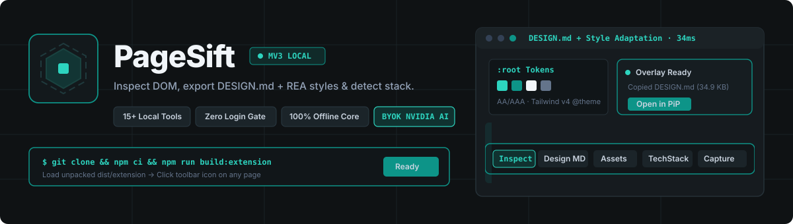

<div align="center">
  
  <br /><br />
  
  
  
  
  
</div>

---

## Download & Install Extension (`v1.1.0`)

PageSift builds both an unpacked Manifest V3 folder and a self-contained ZIP package locally (no account, backend, database, Docker, or AI key required):

- **Local build artifacts** produced by `npm run build:extension`:
  - Downloadable extension archive: `dist/pagesift-extension.zip` (extract the archive, then select the extracted folder in **Load unpacked**)
  - Direct unpacked extension folder: `dist/extension`
  - *Release status note*: No pre-built GitHub Release has been published yet on `QuantumSenpai/pagesift`. Build locally with the commands below before loading into Chromium/Chrome/Brave.

```bash
git clone https://github.com/QuantumSenpai/pagesift.git
cd pagesift
npm ci
npm run build:extension
npm run validate:extension
```

1. Open **`chrome://extensions`** or **`brave://extensions`**.
2. Enable **Developer mode** (top-right).
3. Click **Load unpacked** -> select **`dist/extension`** (or extract **`dist/pagesift-extension.zip`** and load that folder).
4. Pin **PageSift** in the toolbar.

> After updating code, rebuild with `npm run build:extension` and click **Reload** on the extension card.

---

## How to Use

<div align="center">
  
</div>

| Action | Result |
| --- | --- |
| **1 click** on toolbar icon | Opens on-page **Overlay Dock** (auto-injects on open `http`/`https` tabs) |
| **Click again** (while expanded) | Opens **PiP Quick Menu** -> **Settings**, **Compact PiP Window (480x760)**, or **Theme** |
| **Double click** (`<= 420ms`) | Opens **Full Dashboard** (`workspace.html`) |
| **Toolbar click on `chrome://` / `brave://`** | Opens Dashboard directly |
| **`Escape`** key | Cancels active element picker / measure tool or closes drawer |

---

## Tools Quick Reference

| Tool | What To Click & Output |
| --- | --- |
| **Inspect** | Click `Inspect` -> click any page element -> styles, box metrics, fonts, selector, HTML |
| **Measure** | Click `Measure` -> hover/select elements -> exact px distances, padding, gaps |
| **Colors** | Instant palette swatches, usage counts, contrast pairs, CSS/SCSS/JSON/Tailwind v3 & v4 exports |
| **Fonts** | Font families, weights, sizes, line heights, `@font-face` WOFF2 links |
| **Design MD** | Full AI-ready **`DESIGN.md`**: tokens, typography scale, sections, components, `:root` CSS, Tailwind v4 `@theme`, REA completeness + contrast audit |
| **Clone Prompt** | Ready rebuild prompt (`React + Tailwind`, `HTML + CSS`, `Vue 3`, `Generic`) |
| **Clone Page** | Downloads sanitized static HTML/CSS + prefetched assets `.zip` |
| **Assets** | Lists images, SVGs, CSS backgrounds, media, fonts -> single download or `.zip` |
| **Capture** | Visible viewport, cropped region, element, or **Full-Page** stitched (`PNG`, `JPEG`, `WebP`, `PDF`) with annotations |
| **Responsive** | Multi-viewport stage inside overlay + popup windows (`375x812`, `768x1024`, `1280x800`, `1440x900`) + scroll sync |
| **Edit Text / Swap Font / Arrange** | Live reversible text edits, font swaps, move/hide/remove with `Undo` / `Redo` / `Reset` |
| **Design Review** | Contrast, spacing, blur/shadow, and heading hierarchy audit |
| **Tech Stack** | Multi-signal detection with real brand icons & searchable evidence (`React`, `Next.js`, `Framer`, `Webflow`, CDNs, analytics) |
| **Feature Extract** | Local product/UI feature extractor + optional AI analysis |
| **Motion Lab (`v1.1.0`)** | Reverse-engineer animations: inspect declared CSS/WAAPI/scroll timelines, record interactive sessions (`Declared`/`Observed`/`Inferred`/`Unavailable`), replay in isolated preview, compare reference vs reconstruction, import/export Reanimate ZIP/JSON, and export CSS, WAAPI, HTML demo, `MOTION.md` |
| **Activity History** | Auto-logged per-site runs in IndexedDB (`pagesift_local_db v4`), filterable by domain/tool/date, including reopenable Motion Lab sessions |

---

## Optional AI Key (BYOK)

1. Open **PiP Menu -> Settings** (or `options.html` -> Extension Options).
2. Paste your API key (NVIDIA NIM / OpenAI-compatible, stored in `chrome.storage.session` or optional local storage).
3. Use AI enhancement in **Clone Prompt**, **Design Review**, **Tech Stack**, or **Feature Extract** (always previews exact redacted payload digest before sending).

---

## Commands

```bash
npm run build:extension     # Build MV3 unpacked dist/extension + dist/pagesift-extension.zip
npm run validate:extension  # Verify manifest, CSP, icons, bundled fonts, ZIP
npm test                    # Run all unit, backend & Chromium E2E tests
npm run bench:extension     # Run Chromium 2,009-node performance benchmark
npm run check:no-comments   # Verify zero comments across source files
npm run format:check        # Prettier check
npm run lint                # ESLint check
npm run typecheck           # TypeScript check
```

---

## Docs

- [Extension Spec & Feature Matrix](docs/extension-spec-and-matrix.md)
- [Architecture & Data Flow](docs/architecture-and-data-flow.md)
- [Permissions & Privacy](docs/permissions-and-privacy.md)
- [Optional AI Guide](docs/nvidia-ai-guide.md)
- [Performance Report](docs/performance-report.md)
- [Design System & Icon](docs/design-system-and-icon.md)
- [Motion Lab & Reanimate Architecture](docs/motion-lab-reanimate-architecture.md)
- [Sources](docs/sources.md)
