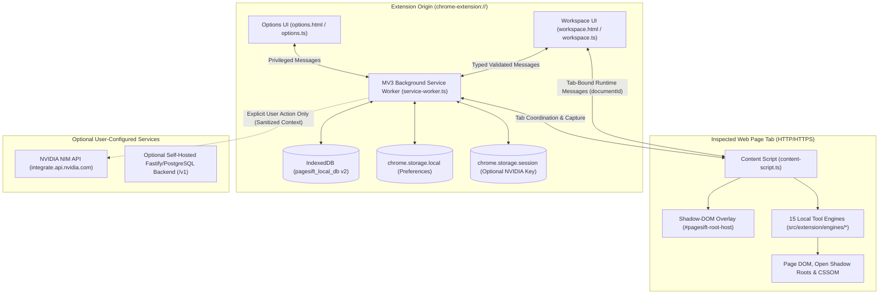

# PageSift Architecture and Data Flow

## 1. Local-First Extension Architecture (Manifest V3)

PageSift is architected as a self-contained Chromium Manifest V3 extension where all 15 inspection, extraction, capture, editing, and export tools run locally inside the user's browser without requiring an account, subscription, or running backend server.

---

## 2. Component Separation and Responsibilities

### A. Content Script (`src/extension/content/content-script.ts`)
- Generates a per-document `documentId` token at injection time. Any runtime message carrying a stale `documentId` from before a navigation event is rejected with `STALE_DOCUMENT`.
- Renders interactive hover/selection/measurement overlays inside an isolated Shadow DOM host (`#pagesift-root-host` with `data-pagesift-root="true"`). All extraction and capture engines filter out `[data-pagesift-root]` so PageSift never inspects or screenshots its own UI.
- Throttles pointer hover updates with `requestAnimationFrame` and separates DOM reads from overlay style writes.
- Maintains a per-document `PageEditController` stack for reversible `Edit Text`, `Swap Font`, and `Arrange` previews with full `Undo`, `Redo`, and `Reset All`, automatically cleaning up listeners and mutations on `Escape` or `pagehide`.

### B. Background Service Worker (`src/extension/background/service-worker.ts`)
- Registers top-level `chrome.runtime.onInstalled`, `chrome.runtime.onStartup`, and `chrome.runtime.onMessage` listeners synchronously at worker startup.
- Validates every incoming message envelope against `runtimeMessageEnvelopeSchema` (`schemaVersion: 1`) and verifies sender identity via `validateSenderAuthorization`.
- Persists job states in the IndexedDB `jobs` store (`v2` schema) and executes `recoverInterruptedJobs()` on service worker wake-up so MV3 worker termination never leaves dangling in-flight state.
- Coordinates privileged operations (`chrome.tabs.captureVisibleTab`, `chrome.windows.create` for responsive viewports, scroll synchronization broadcast with echo suppression, IndexedDB backup/restore, and optional NVIDIA NIM requests).

### C. Extension-Owned UI Pages (`workspace.html`, `options.html`)
- **`workspace.html` / `workspace.ts`**: Action popup and full-tab workspace providing controls for all 15 tools, project/artifact persistence in IndexedDB, reversible edit controls (`Undo`/`Redo`/`Reset`), and optional NVIDIA egress preview & invocation.
- **`options.html` / `options.ts`**: Manages default export preferences (`chrome.storage.local`), session-only NVIDIA API key configuration (`chrome.storage.session`), IndexedDB byte-usage reporting, and validated JSON backup export/import.

### D. Optional Self-Hosted Backend (`src/app.ts`, `src/server.ts`)
- Preserved as an optional Fastify + PostgreSQL 17 modular monolith for users who wish to self-host cloud project/artifact storage later. The Chrome extension does not depend on this server to run any of its 15 tools.
