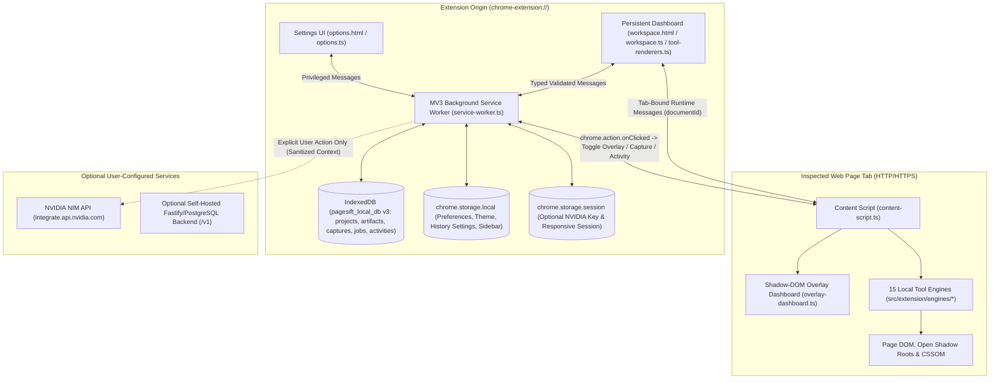

# PageSift Architecture and Data Flow

## 1. Local-First Extension Architecture (Manifest V3)

PageSift is a self-contained Chromium Manifest V3 extension where all 15 inspection, extraction, capture, editing, export, and local research activity history features execute locally inside the browser without requiring login, a subscription, or a running backend server.

---

## 2. Component Separation and Responsibilities

### A. Content Script & On-Page Overlay Dashboard (`src/extension/content/content-script.ts`, `overlay-dashboard.ts`)
- Generates a per-document `documentId` token at injection time and rejects missing or stale bindings with `STALE_DOCUMENT`.
- Injects zero DOM nodes while idle. On explicit activation (`chrome.action.onClicked` -> `TOGGLE_OVERLAY_DASHBOARD`), mounts an isolated Shadow DOM host (`#pagesift-root-host[data-pagesift-root="true"]`) styled with solid Midnight/Warm Paper tokens and bundled local `.woff2` fonts (`web_accessible_resources`).
- All extraction, measurement, cloning, and screenshot engines filter out `[data-pagesift-root]` so PageSift never inspects or captures its own overlay.
- Automatically minimizes the overlay during interactive element picking (`Inspect`, `Measure`, `Edit Text`, `Swap Font`, `Arrange`), restores the overlay after selection with a concise summary + Copy/Download/Open in Dashboard controls, and cleanly removes all injected DOM nodes on Close or `Escape`.
- Coordinates capture preparation/scrolling/restoration, throttled echo-suppressed responsive `SYNC_SCROLL`, and reversible `PageEditController` undo/redo/reset stacks.

### B. Background Service Worker (`src/extension/background/service-worker.ts`)
- Registers top-level `chrome.runtime.onInstalled`, `chrome.runtime.onStartup`, `chrome.action.onClicked`, `chrome.runtime.onMessage`, `chrome.tabs.onRemoved`, `chrome.tabs.onUpdated`, and `chrome.windows.onRemoved` listeners synchronously at startup.
- Gates every message and lifecycle event behind a single-flight `ensureInitialized()` promise (with clean failure reset and structured `STORAGE_ERROR` reporting, no artificial keepalive loops) so ordinary MV3 worker wake-up recovers any stale `running` jobs AND stale `running` activities to `interrupted` and restores active responsive sessions.
- Validates every message envelope and operation payload against Zod schemas (`schemaVersion: 1`) and verifies sender authorization (`validateSenderAuthorization`), restricting history management, settings updates, backup/export, and NVIDIA calls strictly to trusted extension UI pages while allowing content scripts only site-scoped `LIST_SITE_ACTIVITY`, `RECORD_LOCAL_ACTIVITY`, and `OPEN_FULL_DASHBOARD`.
- Records one lifecycle activity entry per explicit tool execution (`running` -> `completed` / `failed` / `cancelled` / `interrupted`) with monotonic `performance.now()` action execution duration and strict URL/options/summary sanitization.
- Executes real screenshot capture (`chrome.tabs.captureVisibleTab` + `OffscreenCanvas` + PDF JPEG XObject assembly), privileged HTTP(S) asset fetching (`asset-fetcher.ts`), responsive preview window management, IndexedDB v3 storage/backup (`schemaVersion: 2` with backwards-compatible `v1` import), and optional NVIDIA NIM requests with mandatory egress preview digest confirmation.

### C. Extension-Owned UI Surfaces (`workspace.html`, `options.html`)
- **`workspace.html` / `workspace.ts` / `tool-renderers.ts`**: Persistent dashboard with collapsible sidebar (`sidebarCollapsed` persisted), three top-level sections (**Tools**, **Activity History**, **Saved Work**), searchable 15-tool rail, structured safe DOM renderers, local Activity History timeline (day/session grouping, 6 filters, search, pagination, Open Result / Reopen Site / Rerun / Delete / Clear History modal, recording toggle), accessible modals (`Escape` + focus restoration), and optional Raw Output disclosure.
- **`options.html` / `options.ts`**: Theme and default export preferences, Activity History recording toggle & retention policy (`Apply Retention Now` / `Clear Activity History`), session-only NVIDIA BYOK key controls, IndexedDB usage metrics (including `activityCount` and real `usedBytes`), JSON backup export/download/file-import, and confirmation-gated full reset.

### D. Optional Self-Hosted Backend (`src/app.ts`, `src/server.ts`)
- Preserved intact as an optional Fastify + PostgreSQL 17 modular monolith with Google OAuth and Neon pooled/direct migration support. The Chrome extension never requires this server or database for any local feature.
