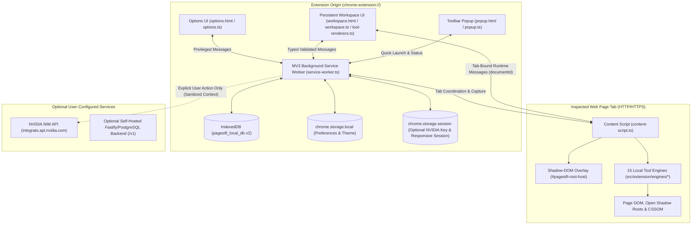

# PageSift Architecture and Data Flow

## 1. Local-First Extension Architecture (Manifest V3)

PageSift is architected as a self-contained Chromium Manifest V3 extension where all 15 inspection, extraction, capture, editing, and export tools run locally inside the user's browser without requiring an account, subscription, or running backend server.

---

## 2. Component Separation and Responsibilities

### A. Content Script (`src/extension/content/content-script.ts`)
- Generates a per-document `documentId` token at injection time. All document-bound operations require a matching `documentId` and reject missing or stale bindings with `STALE_DOCUMENT`.
- Renders interactive hover/selection/measurement overlays inside an isolated Shadow DOM host (`#pagesift-root-host` with `data-pagesift-root="true"`). All extraction and capture engines filter out `[data-pagesift-root]` so PageSift never inspects or screenshots its own UI.
- Coordinates DOM preparation, tile scrolling, and guaranteed `finally` restoration (`CAPTURE_PREPARE`, `CAPTURE_SCROLL_TO`, `CAPTURE_RESTORE`) for background-driven screenshot capture without accepting test fallback data in production paths.
- Emits throttled, echo-suppressed `SYNC_SCROLL` events when registered in an active responsive preview session (`SET_RESPONSIVE_SYNC`), and reports actual inner/outer viewport metrics (`GET_VIEWPORT_METRICS`).
- Maintains a per-document `PageEditController` stack for reversible `Edit Text`, `Swap Font`, and `Arrange` previews with full `Undo`, `Redo`, and `Reset All`, automatically cleaning up listeners and mutations on `Escape` or `pagehide`.

### B. Background Service Worker (`src/extension/background/service-worker.ts`)
- Registers top-level `chrome.runtime.onInstalled`, `chrome.runtime.onStartup`, `chrome.runtime.onMessage`, `chrome.tabs.onRemoved`, `chrome.tabs.onUpdated`, and `chrome.windows.onRemoved` listeners synchronously at worker startup.
- Gates every message and lifecycle event behind a single-flight `ensureInitialized()` promise (with clean failure reset and structured `STORAGE_ERROR` reporting, no duplicate initialization, and no artificial keepalive loops) so ordinary MV3 worker wake-up recovers any previously `running` jobs to `interrupted` and restores active responsive sessions before serving status queries.
- Validates every incoming message envelope and operation-specific payload against Zod schemas (`schemaVersion: 1`) and verifies sender authorization via `validateSenderAuthorization`.
- Persists real `LocalJobRecord` entries in IndexedDB for long-running capture, clone, and asset archive operations, routes active `CANCEL_JOB` signals to `AbortController` instances, and enforces cross-request `captureVisibleTab` rate limiting.
- Runs real screenshot capture (`chrome.tabs.captureVisibleTab` + target tab verification + `OffscreenCanvas` stitching/cropping/annotation/encoding + binary PDF JPEG XObject assembly), privileged HTTP(S) asset fetching (`asset-fetcher.ts` with streaming byte limits and `credentials: 'omit'`), responsive preview window lifecycle & session persistence, IndexedDB storage/backup operations, and optional NVIDIA NIM requests with mandatory egress preview digest confirmation.

### C. Extension-Owned UI Surfaces (`popup.html`, `workspace.html`, `options.html`)
- **`popup.html` / `popup.ts`**: Fast `380px` toolbar launch surface displaying current page inspectability, honest restricted-page notices, one-click launch into the persistent workspace (including quick-launch presets that keep running even after the popup closes), on-page inspector dock toggle, theme switch, and recent local IndexedDB artifacts/jobs.
- **`workspace.html` / `workspace.ts` / `tool-renderers.ts`**: Persistent responsive workbench (`360px` through `1440px` + `200%` zoom) using a shared Light/Dark/System design system (`design-system.css`) and monochrome SVG icons, rendering safe DOM-constructed structured views for all 15 tools (Inspect box model & copy buttons, Assets thumbnail/filter browser with individual downloads, Colors swatches & 5-format exporter, Fonts specimens, Capture preview/crop/callout editor, Responsive requested-vs-measured table, Design Review severity cards, Tech Stack evidence cards), accessible NVIDIA egress preview modal, saved work drawer, and collapsible raw JSON disclosure.
- **`options.html` / `options.ts`**: Manages theme and default export preferences (`chrome.storage.local`), session-only NVIDIA API key configuration (`chrome.storage.session`), IndexedDB usage metric cards, downloadable JSON backup export, file/text backup import, and confirmation-gated local data reset.

### D. Optional Self-Hosted Backend (`src/app.ts`, `src/server.ts`)
- Preserved as an optional Fastify + PostgreSQL 17 modular monolith for users who wish to self-host cloud project/artifact storage later. The Chrome extension does not depend on this server to run any of its 15 tools.
