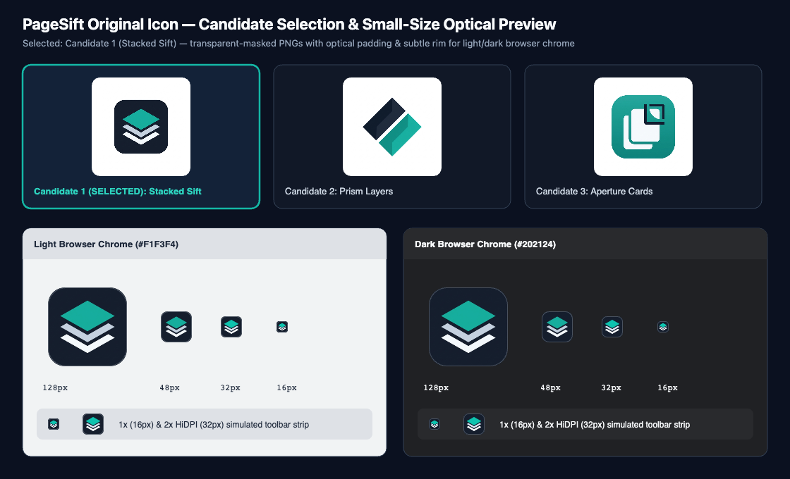

# PageSift Design System, Surface Architecture & Icon Provenance

## 1. Visual Identity & Original Icon Provenance

PageSift uses an original geometric mark ("Stacked Sift") designed independently for PageSift — distinct from Sitepeel and avoiding generic browser-frame clip art, magnifying glasses, or illegible micro-text.

- **Concept**: Three crisp isometric page sheets stacked inside a deep charcoal-slate (`#0F172A`) rounded squircle badge, with the top extracted layer highlighted in PageSift's signature Technical Teal (`#14B8A6`) above cool slate (`#CBD5E1`) and off-white (`#F8FAFC`) layers.
- **Generation Provenance**:
  - Generated three genuinely distinct high-resolution (`1024×1024`) icon candidates using the available `image-generator` tool:
    1. **Candidate 1 (Selected) — Stacked Sift**: Dark charcoal squircle with three layered isometric planes (teal top, silver middle, white bottom). Selected for strongest silhouette and highest clarity at `16×16` on both light and dark browser chrome.
    2. **Candidate 2 — Prism Layers**: Standalone isometric split diamond without outer container (rejected because the dark upper half blended into dark `#202124` browser toolbars).
    3. **Candidate 3 — Aperture Cards**: Teal squircle with overlapping white cards and dark corner bracket (rejected because fine corner geometry lost separation at `16px`).
  - Post-processed Candidate 1 using corner flood-fill alpha masking (preserving the opaque inner white layer while making outer margins cleanly transparent), symmetric bounding-box cropping (`616×616` core), stepped high-quality downscaling, subtle `rgba(203, 213, 225, 0.28)` rim contrast for dark toolbars, and optical padding/vibrancy adjustments at `16px` and `32px`.
- **Delivered Asset Locations**:
  - High-resolution transparent master: `assets/icons/pagesift-master-1024.png`
  - Documentation / store master: `assets/icons/icon-512.png`
  - Packaged Manifest V3 extension & action icons: `assets/icons/icon-16.png`, `assets/icons/icon-32.png`, `assets/icons/icon-48.png`, `assets/icons/icon-128.png` (copied into `dist/extension/icons/` and verified by `scripts/validate-extension-package.ts`).
  - Candidate & toolbar contrast preview sheet: `docs/assets/icon-preview-sheet.png`

---

## 2. Design System Tokens (`src/extension/ui/design-system.css`)

### Color Palette & Contrast

PageSift supports **System**, **Light**, and **Dark** themes persisted via `chrome.storage.local` (`settings.theme`). State is never communicated by color alone (pills pair status dots and explicit text labels).

| Token | Light Theme | Dark Theme | Role |
| :--- | :--- | :--- | :--- |
| `--bg-canvas` | `#F8FAFC` | `#0B1120` | Application backdrop |
| `--bg-surface` | `#FFFFFF` | `#111827` | Cards, rail, header, modals |
| `--bg-subtle` | `#F1F5F9` | `#1E293B` | Secondary surfaces, hover states, chips |
| `--border-subtle` | `#E2E8F0` | `#1F2937` | Structural hairlines |
| `--border-strong` | `#CBD5E1` | `#334155` | Interactive control borders |
| `--text-primary` | `#0F172A` | `#F8FAFC` | Primary copy (> 15:1 contrast) |
| `--text-secondary` | `#334155` | `#CBD5E1` | Secondary labels (> 9:1 contrast) |
| `--text-muted` | `#475569` | `#94A3B8` | Metadata and hints (>= 5.5:1 contrast) |
| `--accent` / `--accent-fg` | `#0F766E` / `#FFFFFF` | `#14B8A6` / `#042F2E` | Primary actions & active navigation (WCAG AA/AAA) |
| `--success` / `--warning` / `--danger` | `#047857` / `#B45309` / `#B91C1C` | `#34D399` / `#FBBF24` / `#F87171` | Semantic status feedback |

### Typography, Spacing, Geometry & Motion

- **UI Font**: `system-ui, -apple-system, BlinkMacSystemFont, "Segoe UI", Roboto, sans-serif`
- **Monospace Font**: `ui-monospace, SFMono-Regular, Menlo, Monaco, Consolas, monospace` (selectors, dimensions, color tokens, URLs, code previews)
- **Type Scale**: `10.5px` uppercase group labels, `11px` pills, `12px` tables/code/metadata, `13px` default body/controls, `16px` active tool heading, `18px` options heading.
- **Spacing & Radii**: `4px` base grid (`4, 8, 12, 16, 20, 24`), `6px` controls, `8px` cards/panels, `10px` dialogs, `999px` status pills.
- **Iconography**: Clean `15×15` stroke-based monochrome inline SVGs (`stroke-width="1.85"`) built via `createElementNS` (zero emoji as primary icons, zero `innerHTML`).
- **Motion**: `120ms–160ms` `cubic-bezier(0.2, 0, 0, 1)` on transform/opacity/color/border; fully disabled under `@media (prefers-reduced-motion: reduce)`.
- **Responsiveness & Accessibility**:
  - Verified zero unintended horizontal overflow at `360px`, `390px`, `768px`, `1280px`, `1440px`, `380px` popup, and `200%` zoom (`640×400` effective CSS px).
  - Slide-out accessible navigation drawer below `900px`, visible `2px` focus rings, skip links, `role="status"` announcements, modal focus management and focus restoration on `Escape`.

---

## 3. Four-Surface Architecture

1. **Toolbar Popup (`popup.html` / `popup.js`)**: Fast `380px` launch surface showing target page status, honest restricted-page messaging (`chrome://`, `file://`, etc.), quick launch directly into the persistent workspace, on-page inspector dock toggle, and recent local IndexedDB artifacts/jobs.
2. **Persistent Workspace (`workspace.html` / `workspace.js` / `tool-renderers.ts`)**: Full-tab persistent workbench grouping all 15 tools into 4 categories with contextual parameters, real-time progress and cancellation, structured safe DOM views (Inspect box model, Assets thumbnail/filter grid with individual downloads, Colors swatches & 5-format token exporter, Fonts specimens, Capture preview/crop/callout editor, Responsive requested-vs-measured table, Design Review severity cards, Tech Stack evidence cards), saved work drawer, and collapsible raw JSON disclosure. Closing the popup never cancels work running in the persistent workspace.
3. **On-Page Inspector Dock & Overlays (`content-script.ts`)**: Shadow DOM root (`#pagesift-root-host[data-pagesift-root="true"]`) excluded from all extraction, measurement, and screenshot capture; distinguishes dashed hover preview from double-rimmed selected element highlight, renders measurement gap badges, provides a compact bottom-right floating dock, and dismisses cleanly on `Escape`.
4. **Options Page (`options.html` / `options.js`)**: Theme and export preferences, session-only BYOK NVIDIA key controls, IndexedDB usage metrics, JSON backup export/download/file-import, accessible confirmation dialog before clearing local data, and transparent local-vs-external request disclosure.

---

## 4. Visual Verification Snapshots

Representative real Chromium screenshots are stored in `docs/assets/screenshots/`:
- `01-popup-light.png`, `02-popup-dark.png`
- `03-workspace-inspect-dark.png`, `04-workspace-assets-light.png`, `05-workspace-capture-dark.png`, `06-workspace-responsive-dark.png`, `07-workspace-colors-light.png`, `08-workspace-narrow-390.png`
- `09-options-light.png`, `10-options-dark.png`, `11-onpage-dock-overlay.png`
