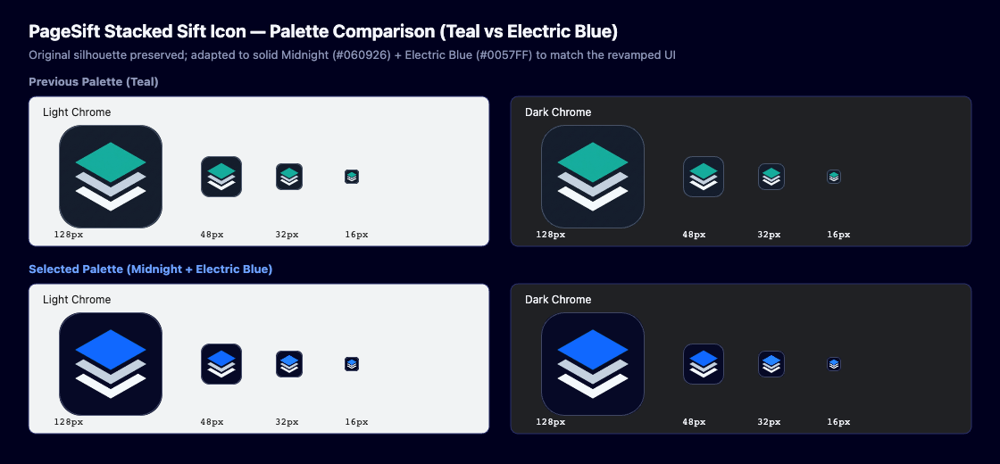

# PageSift Design System, Surface Architecture & Icon Provenance

## 1. Visual Identity & Icon Palette Adaptation

PageSift preserves its original "Stacked Sift" geometric mark while adapting its palette to the Midnight & Electric Blue visual system:

- **Preserved Silhouette**: Three stacked isometric page sheets inside a rounded squircle container — selected originally for clear legibility at `16×16` on both light and dark browser toolbars.
- **Original Master Preserved**: `assets/icons/pagesift-master-1024.png` (teal accent original) remains intact in the repository.
- **Solid-Color Palette Adaptation**:
  - Background squircle flattened to solid deep midnight (`#060926`) with subtle rim contrast for dark browser chrome.
  - Top extracted layer adapted from teal (`#14B8A6`) to solid electric blue (`#0057FF`).
  - Middle (`#CBD5E1`) and bottom (`#F8FAFC`) neutral layers preserved for crisp layering.
- **Delivered Icon Assets**:
  - Adapted master: `assets/icons/pagesift-blue-master-1024.png`
  - Store / documentation size: `assets/icons/icon-512.png`
  - Packaged MV3 extension icons: `assets/icons/icon-16.png`, `assets/icons/icon-32.png`, `assets/icons/icon-48.png`, `assets/icons/icon-128.png` (copied into `dist/extension/icons/` and verified by `scripts/validate-extension-package.ts`).
  - Side-by-side comparison sheet: `docs/assets/icon-palette-comparison.png`

---

## 2. Solid-Color Design System (`src/extension/ui/design-system.css`)

PageSift uses **solid flat colors exclusively** — no atmospheric gradients, no glow shadows, and no translucent glass/backdrop-filter layers.

### Color Tokens

| Token | Dark Theme (Midnight) | Light Theme (Warm Paper) | Role |
| :--- | :--- | :--- | :--- |
| `--bg-canvas` | `#00001E` | `#FDFDFC` | Primary workbench canvas |
| `--bg-surface` | `#070928` | `#FFFFFF` | Sidebar, header, panels, tables |
| `--bg-elevated` | `#0E1138` | `#F7F7F4` | Group headers, notices, subtle elevated regions |
| `--bg-subtle` | `#131747` | `#EFEFEA` | Hover fills and secondary surfaces |
| `--border-subtle` | `#1B2054` | `#E4E4DD` | Crisp 1px structural hairlines |
| `--border-strong` | `#2D3478` | `#C8C8BE` | Interactive input & button borders |
| `--text-primary` | `#F4F6FB` | `#171717` | Primary headings & body copy |
| `--text-secondary` | `#C5CCDF` | `#3F3F3C` | Secondary labels & navigation |
| `--text-muted` | `#8F99BB` | `#5C5C57` | Metadata & helper text |
| `--accent` / `--accent-fg` | `#0057FF` / `#FFFFFF` | `#0057FF` / `#FFFFFF` | Primary actions & active indicators |
| `--accent-surface` / `--accent-text` | `#0A1B54` / `#74A6FF` | `#EBF1FF` / `#0048D6` | Active navigation & tag highlight |
| `--positive` | `#14B8A6` | `#0F766E` | Positive status dots & completion indicators only |
| `--danger` | `#EF4444` | `#DC2626` | Errors & destructive actions only |

### Local Typography, Spacing & Motion

- **Bundled Local Fonts (`dist/extension/fonts/`)**:
  - **Instrument Sans** (`400`, `500`, `600`, `700`, SIL OFL-1.1) for UI controls, navigation, and headings.
  - **IBM Plex Mono** (`400`, `500`, `600`, SIL OFL-1.1) for selectors, dimensions, hex/RGB tokens, URLs, timestamps, and code blocks.
  - Zero external font requests (`fonts.googleapis.com` / third-party CDNs are never called).
- **Readable Type Scale**: `12px` minimum for badges/tags/metadata, `12.5px` monospace tables/code, `13px–13.5px` body and controls, `15px–18px` headings with `tabular-nums` for metrics.
- **Flat Layout Hierarchy**: Open horizontal sections, metric strips, and crisp tables instead of card-inside-card boxes.
- **Restrained Motion**: `110ms–150ms` `cubic-bezier(0.2, 0, 0, 1)` on transform/opacity/color/border; fully disabled under `@media (prefers-reduced-motion: reduce)`.
- **Verified Accessibility & Responsiveness**:
  - Zero horizontal overflow across `360px`, `390px`, `768px`, `1280px`, `1440px`, AND genuine Chromium **200% browser zoom** (`chrome.tabs.setZoom(tabId, 2.0)`).
  - Keyboard-accessible modals (`Escape` + focus restoration), visible `2px` focus rings, skip links, `role="status"` announcements, and collapsible navigation sidebar (`sidebarCollapsed` persisted in `chrome.storage.local`).

---

## 3. Three-Surface Research Workflow

1. **Toolbar Click -> On-Page Overlay Dashboard (`src/extension/content/overlay-dashboard.ts`)**:
   - `manifest.json` omits `action.default_popup` so `chrome.action.onClicked` cleanly toggles the Shadow DOM overlay (`#pagesift-root-host[data-pagesift-root="true"]`) on supported `http(s)://` pages. On restricted browser pages (`chrome://`, `file://`, Web Store), clicking the toolbar icon opens the persistent dashboard with a clear notice (`?unsupportedUrl=...`).
   - Supports expand, minimize to compact bottom-right bar, close (`×` or `Escape`), reopen, instant search across all 15 tools, in-page execution with Copy/Download summaries, automatic minimize during element picking with automatic restore upon selection, site-scoped recent activity list, and one-click handoff to the full dashboard.
   - Completely excluded from extraction, measurement, cloning, and screenshot captures.
2. **Persistent Research Dashboard (`workspace.html` / `workspace.ts` / `tool-renderers.ts`)**:
   - Collapsible sidebar with three top-level sections: **Tools** (all 15 grouped & searchable tools with structured views and optional Raw Output disclosure), **Activity History** (local timeline of explicit PageSift tool runs with day/session grouping, 6 filters, search, pagination, Open Result / Reopen Site / Rerun / Delete / Clear History modal, and recording pause toggle), and **Saved Work** (local projects, artifacts, captures, and persisted background jobs).
3. **Settings Page (`options.html` / `options.ts`)**:
   - Theme and export defaults, Activity History recording toggle & retention cleanup, optional session-only NVIDIA NIM BYOK key, live IndexedDB usage strip (including real byte usage and activity entry count), JSON backup export/download/file-import (`schemaVersion: 2`), and confirmation-gated local reset.

---

## 4. Visual Verification Snapshots

Real Chromium screenshots from the look-and-fix audit are stored in `docs/assets/screenshots/`:
- `revamp_01_overlay_dark.png`, `revamp_02_overlay_minimized.png`, `revamp_03_overlay_light.png`
- `revamp_04_dashboard_inspect_dark.png`, `revamp_05_dashboard_colors_light.png`
- `revamp_06_dashboard_history_dark.png`, `revamp_07_dashboard_history_light.png`, `revamp_08_dashboard_saved_dark.png`
- `revamp_09_dashboard_narrow_390.png`, `revamp_10_dashboard_zoom_200.png`
- `revamp_11_options_dark.png`, `revamp_12_options_light.png`
