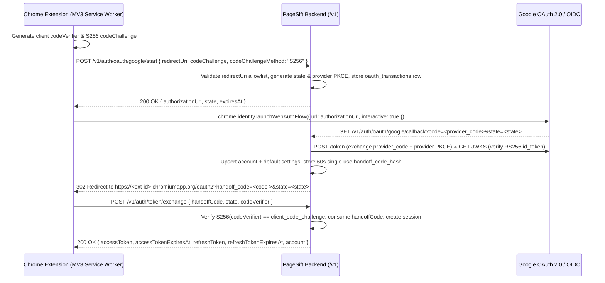

# PageSift Chrome Extension Authentication Integration Guide

## 1. Overview and Security Model

PageSift authenticates Chrome extension users through **Google OpenID Connect (OIDC) / OAuth 2.0 Authorization Code flow with double-layer PKCE**, implemented with `openid-client` (`6.9.1`) and `jose` (`6.2.18`).

### Key Security Properties
1. **No Third-Party Cookie Dependency**: Chrome extensions operate across origins and inside service workers (`Manifest V3`) where third-party cookies are blocked or partitioned. All authenticated API calls use `Authorization: Bearer <accessToken>`.
2. **No Secrets in Redirect URLs**: The callback redirect to `https://<extension-id>.chromiumapp.org/oauth2` contains only a 60-second, single-use `handoff_code` and `state`. It never contains an `accessToken`, `refreshToken`, or session secret. Even if intercepted, a `handoff_code` cannot be exchanged without the extension's private PKCE `codeVerifier`.
3. **Double-Layer PKCE**:
   - **Extension ↔ PageSift Backend**: The extension generates a client PKCE `codeVerifier` and `codeChallenge` (`S256`) before starting sign-in, and presents `codeVerifier` in a `POST` body to `/v1/auth/token/exchange`.
   - **PageSift Backend ↔ Google OIDC**: The backend independently generates a provider PKCE `codeVerifier` and `codeChallenge` (`S256`) using `openid-client` for the authorization code exchange with Google.
4. **No Arbitrary User-ID Session Exchange**: Sessions are created exclusively after cryptographic verification of the provider's RS256 OIDC ID token against the configured JWKS endpoint and verification of the extension's PKCE `codeVerifier`.

---

## 2. Concrete Step-by-Step Extension Flow



### Step 1: Generate Extension PKCE Pair and Initiate Sign-In
In the extension's background service worker:
1. Compute the extension redirect URI via `chrome.identity.getRedirectURL('oauth2')`, which produces `https://<extension-id>.chromiumapp.org/oauth2`.
2. Generate 32 cryptographically random bytes encoded as `base64url` for `codeVerifier`, and compute `codeChallenge = BASE64URL(SHA256(codeVerifier))`.
3. Call `POST /v1/auth/oauth/google/start`:
```json
{
  "redirectUri": "https://aaaaaaaaaaaaaaaaaaaaaaaaaaaaaaaa.chromiumapp.org/oauth2",
  "codeChallenge": "E9Melhoa2OwvFrEMTJguCHaoeK1t8URWbuGJSstw-cM",
  "codeChallengeMethod": "S256"
}
```
4. Store `{ state, codeVerifier }` temporarily in `chrome.storage.session`.

### Step 2: Launch Web Auth Flow and Receive Handoff Code
1. Pass `authorizationUrl` from Step 1 to `chrome.identity.launchWebAuthFlow({ url: authorizationUrl, interactive: true })`.
2. After the user authenticates with Google, Google redirects to `GET /v1/auth/oauth/google/callback`.
3. The backend exchanges the Google authorization code, verifies the RS256 ID token against Google's JWKS endpoint, upserts the account and default settings, and responds with a `302` redirect to:
   `https://<extension-id>.chromiumapp.org/oauth2?handoff_code=<one_time_code>&state=<state>`
4. `chrome.identity.launchWebAuthFlow` resolves with that callback URL string without loading any external web page.
5. Verify that the `state` query parameter matches the `state` stored in `chrome.storage.session`.

### Step 3: Exchange Handoff Code for Session Tokens
Call `POST /v1/auth/token/exchange`:
```json
{
  "handoffCode": "<handoff_code_from_redirect>",
  "state": "<state_from_redirect>",
  "codeVerifier": "<client_code_verifier_from_step_1>"
}
```
The backend atomically consumes the `handoff_code` (valid for 60 seconds, single-use), validates `BASE64URL(SHA256(codeVerifier)) === client_code_challenge`, creates a row in `sessions`, and returns:
```json
{
  "accessToken": "<short_lived_jwt>",
  "accessTokenExpiresAt": "2026-11-21T14:15:00.000Z",
  "refreshToken": "<high_entropy_opaque_token>",
  "refreshTokenExpiresAt": "2026-12-21T14:00:00.000Z",
  "account": {
    "id": "550e8400-e29b-41d4-a716-446655440000",
    "provider": "google",
    "email": "user@example.com",
    "displayName": "Example User",
    "avatarUrl": "https://...",
    "createdAt": "2026-11-21T14:00:00.000Z",
    "updatedAt": "2026-11-21T14:00:00.000Z"
  }
}
```

---

## 3. Allowed Redirect Destinations and CORS Origins

- **`ALLOWED_REDIRECT_URIS`**:
  - Production Chrome extension: `https://<32-char-extension-id>.chromiumapp.org/oauth2`
  - Local development harness: `http://127.0.0.1:5173/auth/callback`
  - Wildcards (`*`), non-loopback `http://` URLs, and URL fragments (`#`) are rejected at startup.
- **`CORS_ALLOWED_ORIGINS`**:
  - Production Chrome extension: `chrome-extension://<32-char-extension-id>`
  - Local development origin: `http://localhost:5173`
  - Wildcard origins (`*`) are rejected at startup. Requests with an unlisted `Origin` header receive `403 FORBIDDEN`.

---

## 4. Credential Storage, Transport, Refresh, and Revocation

### Credential Storage in the Extension
- Store `accessToken` and `accessTokenExpiresAt` in `chrome.storage.session` (in-memory storage cleared when the browser session ends, inaccessible to web page content scripts unless explicitly exposed).
- Store `refreshToken` and `refreshTokenExpiresAt` in `chrome.storage.local` (isolated to the extension origin `chrome-extension://<id>`).
- Never pass `accessToken` or `refreshToken` into inspected web page DOM contexts or content script globals; all `/v1/*` API requests must originate from the extension's background service worker or extension popup/sidepanel page.

### Sending Credentials
Include the access token in the `Authorization` header on all authenticated requests:
```http
Authorization: Bearer <accessToken>
Content-Type: application/json
```

### Token Expiry and Refresh Rotation
- **Access Token TTL**: Default `900` seconds (15 minutes), configurable via `ACCESS_TOKEN_TTL_SECONDS`. Every authenticated request also verifies that the underlying `sessions` row in PostgreSQL is active (`revoked_at IS NULL AND expires_at > NOW()`).
- **Refresh Token Rotation (`POST /v1/auth/token/refresh`)**:
  - Default TTL: `2,592,000` seconds (30 days), configurable via `REFRESH_TOKEN_TTL_SECONDS`.
  - When `accessToken` is within 60 seconds of expiry (or upon receiving `401 UNAUTHORIZED`), the extension calls `POST /v1/auth/token/refresh` with `{ "refreshToken": "<current_refresh_token>" }`.
  - The backend atomically replaces `refresh_token_hash` in PostgreSQL and returns a new `accessToken` and rotated `refreshToken`. The previous `refreshToken` is immediately invalid.

### Sign-Out and Account Deletion
- **Sign-Out (`POST /v1/auth/signout`)**:
  - Pass `{ "allSessions": false }` to revoke only the current session, or `{ "allSessions": true }` to revoke all active sessions for the account.
  - Because `verifyAccessToken` checks the `sessions` table in PostgreSQL on every request, sign-out revokes access tokens **immediately**.
- **Account Deletion (`DELETE /v1/account`)**:
  - Permanently deletes the account row in `accounts` and cascades deletion (`ON DELETE CASCADE`) to `account_settings`, `sessions`, `oauth_transactions`, `projects`, `artifacts`, and `artifact_bodies` within a transaction.

---

## 5. CSRF Protection Analysis

1. **No Ambient Cookie Authentication**: The API never reads session credentials from `Cookie` headers. Browser-initiated cross-site requests cannot attach an `Authorization: Bearer` header automatically.
2. **OAuth State & Double-Layer PKCE**: OAuth initiation binds a cryptographic `state` and the client's `codeChallenge` in `oauth_transactions`. Callback and token exchange verify both `state` and `codeVerifier`, preventing authorization code injection and login CSRF.
3. **Explicit CORS Origin Enforcement**: `@fastify/cors` rejects disallowed `Origin` headers with `403 FORBIDDEN` and only permits preflight for configured extension/development origins.

---

## 6. Verified Behavior vs. Remaining External Setup

- **Verified by Automated Integration Tests**:
  - Full OAuth initiation, provider PKCE challenge generation, authorization code grant against an external HTTP token endpoint, RS256 ID token verification against a live HTTP JWKS endpoint, single-use handoff code exchange with client PKCE verification, refresh token rotation, session revocation, and cascade account deletion.
- **What Automated Tests Do Not Prove / Remaining External Setup**:
  - Tests use a local HTTP OIDC boundary server (`tests/helpers/oidc-boundary-mock.ts`) signing real RS256 JWTs rather than calling live Google servers (`https://accounts.google.com` / `https://oauth2.googleapis.com/token`).
  - Configuring the optional backend with Google OAuth and Neon PostgreSQL does **not** automatically implement Chrome extension sign-in UI or cloud synchronization. PageSift remains a free, local-first extension where all 15 tools run locally without authentication or database connectivity.
  - **Extension Login Integration (Pending)**: No published or fixed Chrome extension ID is established yet. Once an extension ID is established and optional extension sign-in UI is implemented:
    1. Add `chrome-extension://<established-extension-id>` to `CORS_ALLOWED_ORIGINS`.
    2. Add `https://<established-extension-id>.chromiumapp.org/oauth2` to `ALLOWED_REDIRECT_URIS`.
    3. Keep `GOOGLE_CLIENT_SECRET` and database credentials strictly on the backend — never embed them in the extension bundle.
  - **Production Deployment Checklist**:
    1. Use an OAuth 2.0 Client ID (Web Application type) in Google Cloud Console.
    2. Register the backend callback URL (`https://<api-domain>/v1/auth/oauth/google/callback`, or `http://127.0.0.1:3000/v1/auth/oauth/google/callback` for local development) as an Authorized Redirect URI in Google Cloud Console.
    3. Set `GOOGLE_CLIENT_ID`, `GOOGLE_CLIENT_SECRET`, `GOOGLE_CALLBACK_URL`, `DATABASE_URL` (pooled), `DATABASE_URL_UNPOOLED` (direct), `CORS_ALLOWED_ORIGINS`, and `ALLOWED_REDIRECT_URIS`.
